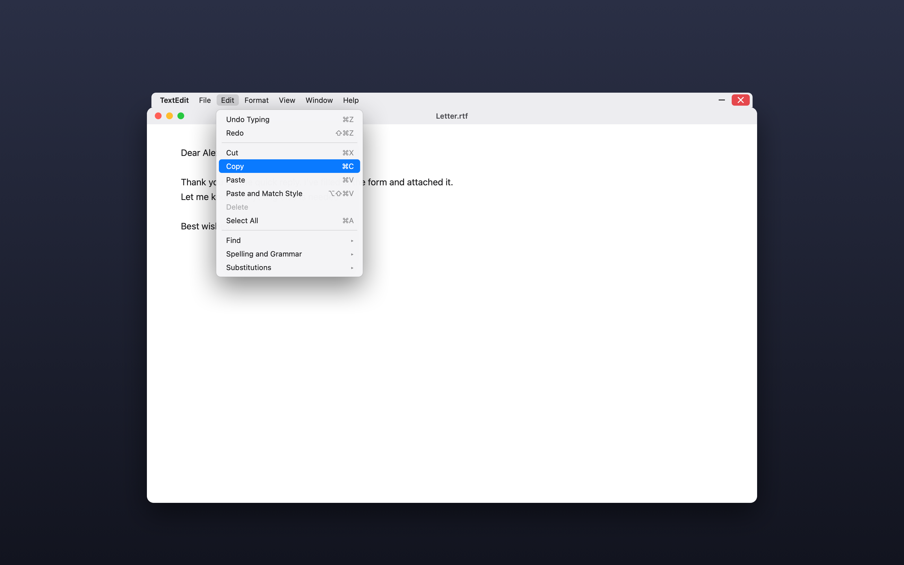

<p align="center"></p>

<h1 align="center">Elmenu</h1>

<p align="center"><b>Each app's menus on its own window, like Windows.</b><br>
File, Edit, View… attached to the window you're in, with minimise and close.</p>

<p align="center">
  <a href="https://github.com/eladitz/elmenu/releases/latest/download/Elmenu.dmg"><b>Download for Mac</b></a> ·
  <a href="https://ai.itzkin.com/elmenu.html">Website</a> ·
  <a href="https://ko-fi.com/eladitzkin">Support on Ko-fi ☕</a>
</p>

<p align="center"></p>

Free and open source. Apple Silicon and Intel, macOS 14 Sonoma or later. Lives in the menu bar.

## What it does

- **The app's own menus, on its window.** A strip with File, Edit, View… sits on top of the window you're in, follows it when you move or resize it, and jumps to the next window when you switch.
- **They're the real menus.** Elmenu reads the app's menus each time you open one, so enabled items, checkmarks, shortcuts and lists like Open Recent are current, and choosing an item does exactly what it does from the top of the screen.
- **Slide between menus** like a menu bar: with one open, point at another to open it.
- **Minimise and ✕**: ✕ quits the app the proper way, so unsaved work still gets its "save?" question.
- **Drag the strip** to move the window.
- **Match Window Colours** (optional): the strip takes the colour of each window's title bar.
- Above the title bar, or under it; hide it for apps you choose; open at login.

## Install

Download [Elmenu.dmg](https://github.com/eladitz/elmenu/releases/latest/download/Elmenu.dmg), open it and drag Elmenu into Applications. It asks once for **Accessibility**, which is how it reads and uses other apps' menus. **Screen Recording** is only needed for Match Window Colours (a thin strip of the title bar is looked at to average its colour). Nothing is saved or sent anywhere.

## Build it yourself

Needs the Command Line Tools (`xcode-select --install`), not Xcode.

```bash
./build.sh      # build/Elmenu.app
./package.sh    # build/Elmenu.dmg
```

| File | What's in it |
|---|---|
| `Sources/App.swift` | Menu bar app, settings, permission |
| `Sources/Strip.swift` | The strip: following the window, dragging, – and ✕, sliding between menus |
| `Sources/MenuMirror.swift` | Reading an app's menus (Accessibility) and rebuilding them as real menus |
| `Sources/WindowColour.swift` | Match Window Colours |
| `Sources/Donate.swift`, `Updater.swift` | Monthly Ko-fi note, daily update check |

## Support

Elmenu is free and made by one person. If it makes your Mac feel more like home, a coffee on **[Ko-fi](https://ko-fi.com/eladitzkin)** keeps it going.

MIT licensed.
